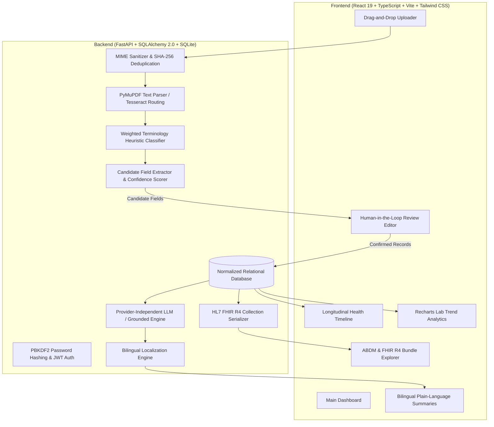

# Swasthya Copilot — Your Personal Health Intelligence Platform

> **"Your Health Records. Clearly Connected."**  
> AI-Powered Personal Health Intelligence Platform | Hackathon-Ready Full-Stack Application

---

## 1. Executive Summary & Problem Statement

Patients across India often possess critical medical records scattered across paper prescriptions, diagnostic lab reports, discharge summaries, and clinic notes. They struggle to comprehend clinical jargon, recognize out-of-range laboratory values, adhere to dosing schedules, or trace metabolic changes over time.

**Swasthya Copilot** converts fragmented medical documents into organized, understandable, traceable personal health intelligence. The platform enforces clinical safety boundaries: it serves as an evidence-grounded informational assistant, not a diagnostic engine or replacement for a licensed healthcare provider.

---

## 2. Core Architecture & Pipeline



---

## 3. Key Implemented Features

1. **Document Upload & Ingestion**: Drag-and-drop support for PDF, JPG, JPEG, and PNG files with SHA-256 duplicate detection.
2. **PyMuPDF & OCR Pipeline**: Extracts digital text from PDFs and routes scans through image preprocessing (grayscale, contrast adjustment, sharpening).
3. **Document Classification**: Categorizes records into **Prescriptions**, **Laboratory Reports**, **Discharge Summaries**, or **Diagnostic Imaging**.
4. **Mandatory Human-in-the-Loop Review**: Side-by-side verification editor displays raw OCR source alongside editable candidate fields with High/Medium/Low confidence indicators.
5. **Distinctive Differentiator — Evidence-Linked Intelligence**: Every AI health insight includes a **"View Source"** action displaying exact supporting measurements, report dates, and document IDs.
6. **Bilingual Multilingual Experience**: Full **English** and **Telugu** support across UI navigation, status badges, and AI clinical summaries.
7. **Longitudinal Lab Trends (Recharts)**: Interactive time-series charts for HbA1c, Fasting Blood Sugar, Total Cholesterol, and Serum Creatinine.
8. **ABDM & FHIR R4 Interoperability**: Generates valid HL7 FHIR Release 4 Collection Bundles with mock ABHA identifiers (`91-9876-5432-1098`) and LOINC codings.
9. **Patient Privacy & Consent**: Granular consent settings (Clinical Sharing, AI Processing, Research Analytics) and immutable audit logging.
10. **1-Click Hackathon Demo Scenario**: Instant seeding of realistic synthetic patient **Sita Ramanathan** with 6 clinical records demonstrating trend progression from Jan to Mar 2026.

---

## 4. Technology Stack

- **Frontend**: React 19, TypeScript, Vite, Tailwind CSS, Lucide React, Recharts, React Router DOM, Axios.
- **Backend**: Python 3.14 / 3.11+, FastAPI, Pydantic V2, SQLAlchemy 2.0 ORM, SQLite (PostgreSQL migration ready).
- **Extraction & OCR**: PyMuPDF (`pypdf`), Pillow image preprocessing, Tesseract OCR routing with status detection.
- **AI / LLM Layer**: Provider-independent adapter supporting local Ollama (`qwen2.5:7b`) with deterministic fallback to safe evidence-grounded templates.
- **Standards & Interop**: HL7 FHIR R4 JSON Schema, LOINC lab test codes, mock ABHA numbers.

---

## 5. Quickstart & Local Setup Instructions

### Prerequisites
- Python 3.11+ (tested on Python 3.14)
- Node.js 18+ and npm

### Step 1: Backend Setup
```powershell
# Navigate to backend directory
cd swasthya-copilot/backend

# Install dependencies
python -m pip install -r requirements.txt

# Launch FastAPI backend server (runs on port 8000)
python -m uvicorn app.main:app --host 0.0.0.0 --port 8000 --reload
```
API Documentation will be live at: `http://localhost:8000/docs`

### Step 2: Frontend Setup
```powershell
# Open a new terminal and navigate to frontend directory
cd swasthya-copilot/frontend

# Install dependencies (already installed if using repo)
npm.cmd install

# Start Vite development server (runs on port 5173)
npm.cmd run dev
```
Open your browser at: `http://localhost:5173`

---

## 6. How to Run Automated Tests & Benchmarks

Run the complete backend test suite and the field-level extraction accuracy benchmark:
```powershell
cd swasthya-copilot/backend
python -m pytest -v
```

### Benchmark Results (`tests/test_benchmark.py`):
```
Benchmark Category 'dates': 4/4 (100.0%)
Benchmark Category 'medicine_names': 2/2 (100.0%)
Benchmark Category 'dosages': 2/2 (100.0%)
Benchmark Category 'test_names': 2/2 (100.0%)
Benchmark Category 'test_values': 2/2 (100.0%)
Benchmark Category 'units': 2/2 (100.0%)
Benchmark Category 'reference_ranges': 2/2 (100.0%)
======================= 8 passed in 0.65s =======================
```

---

## 7. How to Run the 1-Click Demo
1. Open `http://localhost:5173`
2. Click **"Launch 1-Click Interactive Demo"** on the landing page (or click **"Load Demo Dataset"** in the top navigation).
3. The platform seeds synthetic patient **Sita Ramanathan (48F)** with:
   - **Lab Report 1 (Jan 2026)**: Baseline HbA1c 8.2% (High), Fasting Glucose 156 mg/dL (High).
   - **Prescription (Jan 2026)**: Metformin 500mg, Telmisartan 40mg, Atorvastatin 10mg.
   - **Lab Report 2 (Mar 2026)**: Follow-up HbA1c 7.1% (Decreased), Fasting Glucose 124 mg/dL.
   - **Discharge Summary (Nov 2025)**: KIMS Hospital Cardiology evaluation.
   - **Diagnostic Report (Feb 2026)**: Ultrasound Abdomen (Grade 1 fatty liver).
   - **Pending Review Record**: Community health prescription demonstrating the Human-in-the-Loop review editor.
4. Toggle between **English** and **తెలుగు** in the navbar to test bilingual translations.
5. Click **"View Source"** on any insight card to trace evidence back to the exact report.
6. Open **"ABDM & FHIR R4"** to copy or download the complete FHIR R4 Bundle.

---

## 8. Clinical Safety & Boundary Statement
- **Informational Assistant Only**: Swasthya Copilot explicitly states on all pages:  
  *"This AI-generated explanation is for informational purposes only. It is not a diagnosis or a substitute for advice from a qualified healthcare professional."*
- **No Unconfirmed AI Overwrites**: OCR outputs cannot alter verified medical records without human confirmation in the review interface.
- **No Hallucinated Claims**: All findings are cited directly to stored numeric values and laboratory reference intervals.
