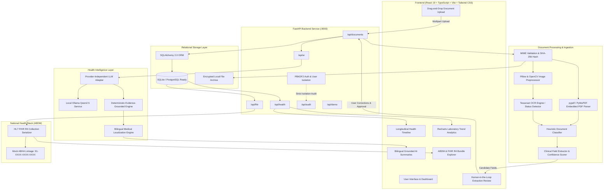

# Swasthya Copilot — Architecture & Data Pipeline Specification

## 1. System Overview
**Swasthya Copilot** is an AI-powered personal health intelligence platform designed for the Indian healthcare ecosystem. It converts fragmented medical prescriptions, laboratory reports, discharge summaries, and diagnostic tests into traceable, plain-language health records in **English** and **Telugu**, with full **ABDM / FHIR R4** interoperability.

---

## 2. Mermaid Architecture Diagram

---

## 3. The 12-Stage Data Pipeline

1. **Document Upload & Sanitization**: Enforces MIME checking, max 25MB constraint, and SHA-256 content hashing to block duplicates.
2. **Secure Disk Storage**: Files stored under randomized UUID hex names outside web root to prevent path traversal.
3. **Text Extraction**: Uses `pypdf` for digital vector PDFs; routes scanned documents to image preprocessing.
4. **Image Preprocessing**: Auto-contrast adjustment, grayscale conversion, and denoising filter.
5. **OCR Engine Routing**: Detects installed Tesseract language packs; provides clear diagnostic notice if binary is missing.
6. **Clinical Document Classification**: Weighted terminology heuristic parses documents into Prescriptions, Lab Reports, Discharge Summaries, or Diagnostics.
7. **Structured Medical Field Extraction**: Extracts specific entities (drugs, doses, frequencies, test names, numerical values, units, reference intervals).
8. **Field Confidence Scoring**: Labels fields as High, Medium, or Low with exact source text snippets for traceability.
9. **Mandatory Human-in-the-Loop Review**: Users compare OCR results side-by-side with original document before saving.
10. **Verified Database Persistence**: Only user-confirmed values enter the clinical database (Observation, Medication, Discharge, Timeline tables).
11. **Grounded AI Summary Generation**: Multi-provider adapter uses local Ollama or deterministic evidence engine to generate 7 structured sections in English and Telugu.
12. **ABDM / FHIR R4 Bundle Export**: Converts stored observations into HL7 FHIR R4 resources with LOINC codings and mock ABHA IDs.
